JavaScript Graph Drawing Libraries
=======================

This is a list of known graph drawing libraries. See [a website with interactive data](https://anvaka.github.io/graph-drawing-libraries/#/all).

<!-- wall:start -->
<!-- "npm run screenshots" in src writes this block, do not edit it by hand -->
The same 10×10 grid, 10 seconds after each library started to draw it. Click a picture to run the demo:

<p>
<a href="https://anvaka.github.io/graph-drawing-libraries/performance/?lib=antvis_G6&amp;graph=grid&amp;n=10&amp;m=10">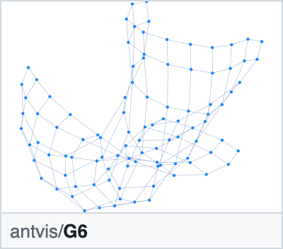</a>
<a href="https://anvaka.github.io/graph-drawing-libraries/performance/?lib=anvaka_VivaGraphJS&amp;graph=grid&amp;n=10&amp;m=10">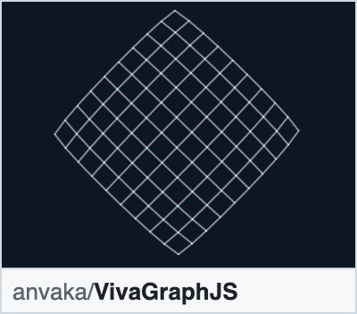</a>
<a href="https://anvaka.github.io/graph-drawing-libraries/performance/?lib=apache_echarts&amp;graph=grid&amp;n=10&amp;m=10">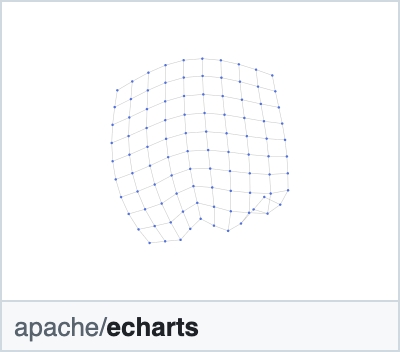</a>
<a href="https://anvaka.github.io/graph-drawing-libraries/performance/?lib=cosmosgl_graph&amp;graph=grid&amp;n=10&amp;m=10">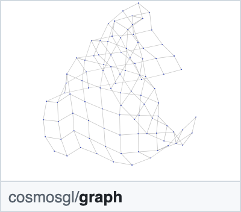</a>
<a href="https://anvaka.github.io/graph-drawing-libraries/performance/?lib=cytoscape_cytoscape.js&amp;graph=grid&amp;n=10&amp;m=10">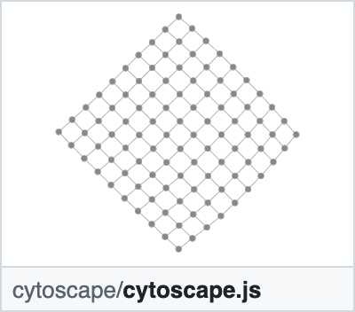</a>
<a href="https://anvaka.github.io/graph-drawing-libraries/performance/?lib=mbostock_d3&amp;graph=grid&amp;n=10&amp;m=10">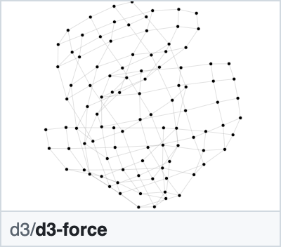</a>
<a href="https://anvaka.github.io/graph-drawing-libraries/performance/?lib=cpettitt_dagre&amp;graph=grid&amp;n=10&amp;m=10">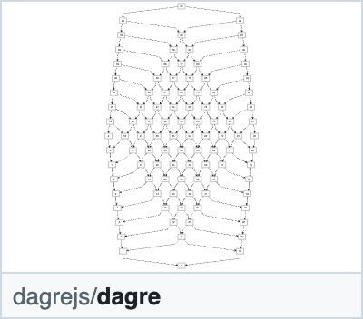</a>
<a href="https://anvaka.github.io/graph-drawing-libraries/performance/?lib=dhotson_springy&amp;graph=grid&amp;n=10&amp;m=10">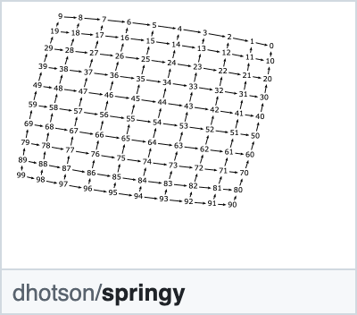</a>
<a href="https://anvaka.github.io/graph-drawing-libraries/performance/?lib=ecomfe_echarts-gl&amp;graph=grid&amp;n=10&amp;m=10">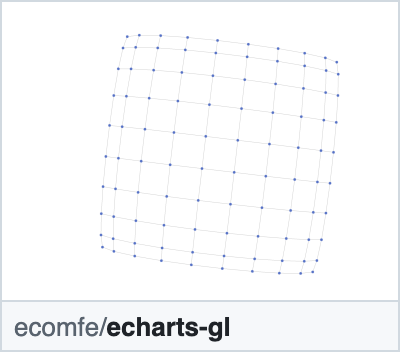</a>
<a href="https://anvaka.github.io/graph-drawing-libraries/performance/?lib=fkling_JSNetworkX&amp;graph=grid&amp;n=10&amp;m=10"></a>
<a href="https://anvaka.github.io/graph-drawing-libraries/performance/?lib=GraphAlchemist_Alchemy&amp;graph=grid&amp;n=10&amp;m=10">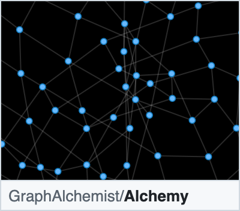</a>
<a href="https://anvaka.github.io/graph-drawing-libraries/performance/?lib=jacomyal_sigma.js&amp;graph=grid&amp;n=10&amp;m=10">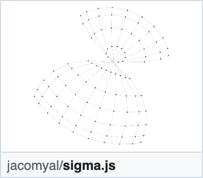</a>
<a href="https://anvaka.github.io/graph-drawing-libraries/performance/?lib=kieler_elkjs&amp;graph=grid&amp;n=10&amp;m=10">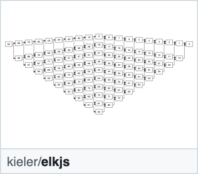</a>
<a href="https://anvaka.github.io/graph-drawing-libraries/performance/?lib=mdaines_viz-js&amp;graph=grid&amp;n=10&amp;m=10">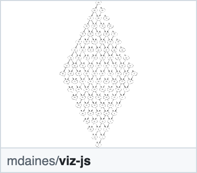</a>
<a href="https://anvaka.github.io/graph-drawing-libraries/performance/?lib=memgraph_orb&amp;graph=grid&amp;n=10&amp;m=10">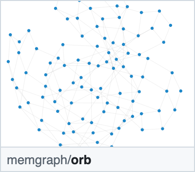</a>
<a href="https://anvaka.github.io/graph-drawing-libraries/performance/?lib=microsoft_msagljs&amp;graph=grid&amp;n=10&amp;m=10">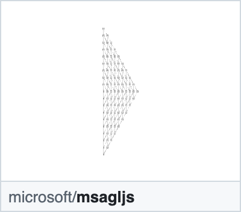</a>
<a href="https://anvaka.github.io/graph-drawing-libraries/performance/?lib=samizdatco_arbor&amp;graph=grid&amp;n=10&amp;m=10">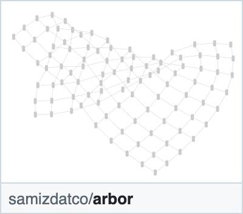</a>
<a href="https://anvaka.github.io/graph-drawing-libraries/performance/?lib=strathausen_dracula&amp;graph=grid&amp;n=10&amp;m=10">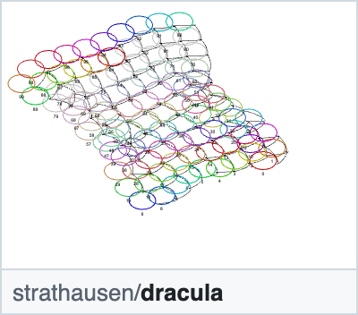</a>
<a href="https://anvaka.github.io/graph-drawing-libraries/performance/?lib=tgdwyer_WebCola&amp;graph=grid&amp;n=10&amp;m=10">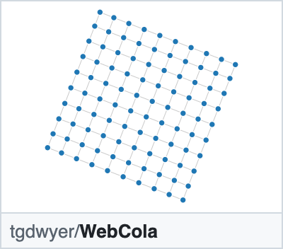</a>
<a href="https://anvaka.github.io/graph-drawing-libraries/performance/?lib=vasturiano_3d-force-graph&amp;graph=grid&amp;n=10&amp;m=10">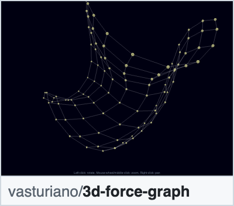</a>
<a href="https://anvaka.github.io/graph-drawing-libraries/performance/?lib=vasturiano_force-graph&amp;graph=grid&amp;n=10&amp;m=10">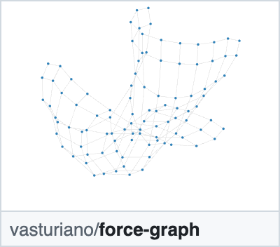</a>
<a href="https://anvaka.github.io/graph-drawing-libraries/performance/?lib=visjs_vis-network&amp;graph=grid&amp;n=10&amp;m=10"></a>
</p>
<!-- wall:end -->

* [antvis/G6](https://github.com/antvis/G6) - A Graph Visualization Framework in JavaScript.
* [anvaka/VivaGraphJS](https://github.com/anvaka/VivaGraphJS) - Graph drawing library for JavaScript
* [apache/echarts](https://github.com/apache/echarts) - A powerful, interactive charting and data visualization library for browser
* [cosmosgl/graph](https://github.com/cosmosgl/graph) - GPU-accelerated force graph layout and rendering
* [cytoscape/cytoscape.js](https://github.com/cytoscape/cytoscape.js) - Graph theory (network) library for visualisation and analysis
* [d3/d3-force](https://github.com/d3/d3-force) - Force-directed graph layout using velocity Verlet integration.
* [dagrejs/dagre](https://github.com/dagrejs/dagre) - Directed graph layout for JavaScript
* [dhotson/springy](https://github.com/dhotson/springy) - A force directed graph layout algorithm in JavaScript
* [ecomfe/echarts-gl](https://github.com/ecomfe/echarts-gl) - Extension pack for Apache ECharts; its graphGL series draws graphs with WebGL and lays them out on the GPU
* [fkling/JSNetworkX](https://github.com/fkling/JSNetworkX) - Build, process and analyze graphs in JavaScript (port of NetworkX)
* [GraphAlchemist/Alchemy](https://github.com/GraphAlchemist/Alchemy) - a graph drawing application built in d3.
* [jacomyal/sigma.js](https://github.com/jacomyal/sigma.js) - A JavaScript library aimed at visualizing graphs of thousands of nodes and edges
* [kieler/elkjs](https://github.com/kieler/elkjs) - ELK's layout algorithms for JavaScript
* [mdaines/viz-js](https://github.com/mdaines/viz-js) - Graphviz in your browser
* [memgraph/orb](https://github.com/memgraph/orb) - Graph visualization library
* [microsoft/msagljs](https://github.com/microsoft/msagljs) - A JavaScript graph layout engine: port of MSAGL
* [samizdatco/arbor](https://github.com/samizdatco/arbor) - a graph visualization library using web workers and jQuery
* [strathausen/dracula](https://github.com/strathausen/dracula) - JavaScript layout and representation of connected graphs.
* [tgdwyer/WebCola](https://github.com/tgdwyer/WebCola) - Javascript constraint-based graph layout
* [vasturiano/3d-force-graph](https://github.com/vasturiano/3d-force-graph) - 3D force-directed graph component using ThreeJS/WebGL
* [vasturiano/force-graph](https://github.com/vasturiano/force-graph) - Force-directed graph rendered on HTML5 canvas
* [visjs/vis-network](https://github.com/visjs/vis-network) - Display dynamic, automatically organised, customizable network views.

If you find something missing, please let me know.

## Commercial software

* [Graphistry](https://www.graphistry.com/get-started) - GPU client+server accelerated, point-and-click filtering/histograms/timebars/coloring/clustering, language-neutral REST and JavaScript/React/Python embedding APIs, [data science notebook support](https://github.com/graphistry/pygraphistry), all major browsers from last 5+ years + mobile

Video
=====

*NOTE: This video is outdated. Keeping it for historical reasons only*

Side by side rendering of the grid graph by 12 libraries: https://www.youtube.com/watch?v=Ax7KSQZ0_hk 

Website
=======

The website lives in the [src](src) folder. It is a static [Vite](https://vite.dev) project
with no backend:

```sh
cd src
npm install
npm run dev     # local development server
npm run stats   # refresh GitHub statistics in data/stats.json
npm run screenshots   # retake the pictures of the libraries in this file (needs Chrome)
npm run measure       # measure how large a graph each library takes before it freezes the tab (needs Chrome)
npm test
npm run build   # production version in src/dist
```

* `data/libraries.json` is the list of libraries on the website. `example` points to a folder
  in `public/examples` with a "hello world" demo (`01.basic`) and a performance test (`02.perf`).
* "Run demo" in the list opens the performance test of a library (`performance/`). The page
  lists the other libraries: each is a link that draws the same graph with that library.
* `data/stats.json` holds GitHub statistics of these libraries. The
  [deploy workflow](.github/workflows/deploy.yml) runs on pushes to `main` and once a week:
  it fetches fresh statistics and publishes the website to GitHub Pages. The committed file
  is a snapshot for local development, and a fallback when GitHub API is not available.
* `app/graphs.js` is the list of graphs that the performance test can render. They are the
  graphs of the [ngraph.forcelayout demo](https://anvaka.github.io/ngraph.forcelayout/) under
  the same names, plus generators of a size that the visitor chooses. Nothing is copied here:
  `app/loadGraph.js` downloads the files from the deployed demo and from its
  [SuiteSparse](https://sparse.tamu.edu) mirror.
* `app/guard.js` keeps a slow library from freezing the tab without warning. The performance
  test asks before it starts a graph only when a freeze is likely: the library froze a tab on
  a graph this large when we measured it, or it froze the browser of the visitor before.
  `npm run measure` does the measurements. It gives every library square grids and graphs of the
  picker in a Chrome that is slowed down four times, and writes down the smallest graph that
  kept the tab silent for ten seconds: all runs are in `data/measurements.json`, the limits made
  from them in `data/limits.json`.
* A pull request that changes `src` gets a preview: the
  [preview workflow](.github/workflows/preview.yml) publishes it to
  `https://anvaka.github.io/graph-drawing-libraries/pr-preview/pr-<number>/` and posts the
  link to the pull request. Pull requests from forks have no previews.

Why?
====
This repository is inspired by [@mbektimirov](https://github.com/mbektimirov)'s question [Difference with Sigma.js](https://github.com/anvaka/ngraph/issues/6). I am trying to list all known graph drawing libraries, and [inviting their authors](https://github.com/anvaka/graph-drawing-libraries/issues/1) to collaborate here.
